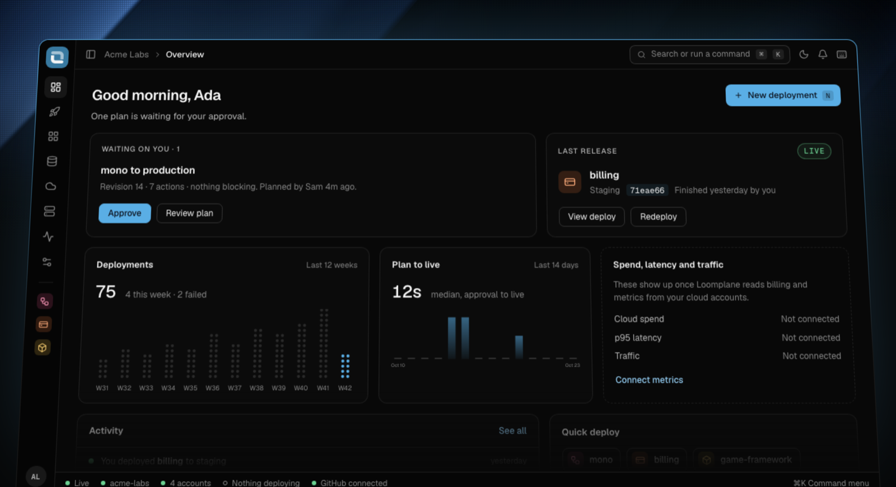
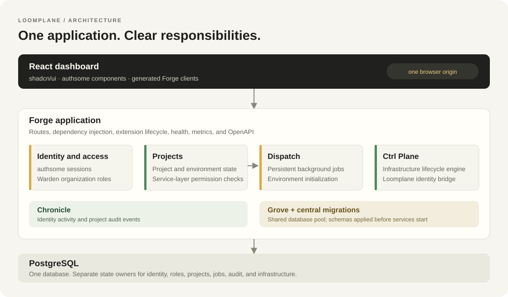

<p align="center">
  <a href="https://www.loomplane.com">
    <picture>
      <source media="(prefers-color-scheme: dark)" srcset="apps/dashboard/src/assets/brand/loomplane-logo-dark.svg" />
      
    </picture>
  </a>
</p>

<p align="center"><strong>Your infrastructure, woven together.</strong></p>

<p align="center">
  A self-hosted deployment platform for the monorepos you already have.<br />
  Built with Go, React, and the Forge ecosystem.
</p>

<p align="center">
  
  <a href="LICENSE"></a>
</p>

<p align="center">
  <a href="https://www.loomplane.com">Website</a> ·
  <a href="https://www.loomplane.com/docs">Docs</a> ·
  <a href="#quick-start">Quick start</a> ·
  <a href="#deploy-something">Deploy something</a> ·
  <a href="#what-it-does">What it does</a> ·
  <a href="#architecture">Architecture</a>
</p>



<p align="center"><sub>The Overview, with sample data, the way the landing page draws it.</sub></p>

Loomplane takes a Go, Rust, TypeScript, JavaScript, Python or JVM monorepo, or an application split across several repositories, from source to running services across clouds. You give it the repositories. It reads the code (never runs it) to find the services and the databases they need, drafts a `loomplane.yaml`, and plans what deploying it would do. Once someone approves that exact plan, it builds each service on its cloud's own builder and deploys it: a Next.js app to Vercel, a Go API to Cloud Run, a worker to ECS on Fargate, Postgres on Cloud SQL or RDS, wired to each other with secrets kept in each cloud's secret store. Then it keeps checking that what runs is what it deployed.

Your applications don't need Forge, or Go. Everything runs in your own clouds, on your own accounts.

## Quick start

You'll need Go 1.26 (the right patch release downloads itself), Node.js 24 with pnpm, and Docker with Compose for the local PostgreSQL.

```bash
make up                                       # PostgreSQL on localhost:55532
cp config.local.yaml.example config.local.yaml
make setup
make run
```

Open [localhost:8780](http://localhost:8780), create an account, and name your organization.

No Go or Node on your machine? `make stack` builds the image and runs everything in Docker on the same port. It runs in development mode with the development secret key, which is fine on a laptop and nowhere else: set `LOOMPLANE_ENVIRONMENT=production`, `LOOMPLANE_SECRET_KEY` and an https `LOOMPLANE_PUBLIC_URL`, and production refuses to start without them.

For a production host, use the [production Docker guide](docs/docker-production.md). It covers the API, dashboard, analysis worker, Postgres, HTTPS, persistent storage, backups and versioned image releases. To skip containers, [Install on Linux](https://www.loomplane.com/docs/operations/linux) puts the server on the host from a `.deb`, an `.rpm` or an archive and runs it under systemd. To run it highly available on Kubernetes, use the [Helm chart](docs/kubernetes.md), to run on Miget, follow the [Miget guide](docs/miget.md), and to host it on DigitalOcean, follow the [DigitalOcean guide](docs/digitalocean-hosting.md).

[](https://cloud.digitalocean.com/apps/new?repo=https://github.com/xraph/loomplane/tree/main)

For hot reload while you work on Loomplane itself, `make dev` serves the dashboard on [localhost:5173](http://localhost:5173) and reloads the API as you edit.

## Deploy something

1. **New project**, with a GitHub URL. Any public monorepo works; private ones go through a GitHub App ([docs/github-app.md](docs/github-app.md)).
2. **Analyze**. You get the services it builds, the packages they share and the databases they need, each linked to the line it came from.
3. Open **Deploy**. Loomplane drafts a `loomplane.yaml`; edit it, and save it. [docs/manifest.md](docs/manifest.md) has every field.
4. Under **Integrations**, connect the clouds it names: a Google Cloud service account key, a Vercel token, an AWS access key, a Render API key, a DigitalOcean API token, an Azure service principal. Each is checked with its cloud before it's kept, and Loomplane says which permissions are missing.
5. **Plan** an environment. You see every action, step by step, with anything in the way and anything worth knowing.
6. An admin approves it. You watch each step build, deploy and answer, and the environment shows what runs where.

The same thing from a terminal. Install `loomctl` with `brew install xraph/tap/loomctl`, or on Linux from the release's `.deb`, `.rpm` or archive ([Install on Linux](https://www.loomplane.com/docs/operations/linux#install-loomctl)). `loomctl login` opens the dashboard so you can approve its sign-in; CI uses an API key from **Settings, API keys** with `--key -` instead:

```bash
loomctl login --url http://localhost:8780
loomctl analyze mono
loomctl manifest save mono -f loomplane.yaml
loomctl plan mono --env production
loomctl approve <plan-id>
```

## What it does

| | |
|---|---|
| Repository discovery | Go, Rust, Node, Python and JVM (Maven and Gradle) monorepos, Dockerfiles and Compose files, with Forge layouts, app roles and scoped backend configuration. [Discovery rules](docs/repository-discovery.md) cover examples and development helpers. |
| `loomplane.yaml` | A versioned manifest, drafted from the analysis: services, resources, gateways, and overrides per environment. |
| Plans | Every action a deployment would take, in order, with problems that block it. Approval names the revision you reviewed; a plan whose world changed comes back stale. |
| Targets | Vercel, Cloud Run, ECS on Fargate, Render, DigitalOcean App Platform and Azure Container Apps for services; Cloud SQL, RDS, Memorystore, ElastiCache, Cloud Storage, S3, Render's Postgres and Key Value, DigitalOcean's Managed PostgreSQL, MySQL and Valkey, and Azure Database for PostgreSQL and MySQL and Azure Managed Redis for databases, caches and buckets. Builds run on Cloud Build, CodeBuild, Vercel, Render, App Platform and ACR Tasks, in your accounts. |
| Networking | Services find each other through variables. ECS services reach each other privately; private Cloud Run services only take calls from the project's own. |
| Gateways | One public address routing paths to services, built on Bastion and run on your infrastructure. |
| Secrets | Variables in layers (organization, project, service, by environment), secrets in Vault and then in each cloud's secret store, never shown again. |
| Recovery | A failed deployment retries from the step that failed. |
| Drift | A scheduled check compares everything deployed with what's live, and the next plan puts it back. |
| Provider plugins | Add a target without changing Loomplane: [docs/providers.md](docs/providers.md). |
| CLI and API keys | `loomctl` for terminals and CI, on keys that act as you with your role, read-only if you like. |
| AI agents | `loomctl mcp` gives an agent tools to analyze, plan and, if you allow it, approve: [docs/agents.md](docs/agents.md). |
| Operations | Backups, restores, safe upgrades and Prometheus metrics: [docs/operations.md](docs/operations.md). |
| Organizations | Members, invitations, Warden roles, and an audit trail of every change. |

## Architecture



Loomplane is one Forge application and a worker. The same Go process serves the dashboard and the API, runs the deployment workflows, and hosts Ctrl Plane; `loomplane-worker` analyzes repositories. Both use one PostgreSQL database.

| Library | What Loomplane uses it for |
|---|---|
| Forge | HTTP, dependency injection, extension lifecycle, health, metrics, OpenAPI, and the CLIs |
| Grove | The database pool and one migration pass over every library's schema |
| authsome | Users, sessions, organizations and invitations |
| Warden | Roles in each organization, checked on every action |
| Dispatch | Jobs, cron, and the durable deployment workflow that waits days for an approval |
| Ctrl Plane | The lifecycle of long-running services on Cloud Run and ECS |
| Vault | Cloud credentials, secret variables and generated database passwords |
| Keysmith | API keys |
| Chronicle | The audit trail |
| Trove | Each deployment's source |
| Bastion | Gateways, generated and run on your infrastructure |

Domain logic is in `internal/`, Forge wiring in `extensions/`. [docs/architecture.md](docs/architecture.md) follows startup, state ownership and trust boundaries; [docs/forge-integration.md](docs/forge-integration.md) has every library pin and what we found wiring each one.

## Who can do what

Your session or API key picks the organization, and nothing in a request can change it. Another organization's things aren't found.

| Role | Can |
|---|---|
| Viewer | Read everything but secret values |
| Developer | Create projects, analyze, edit manifests and variables, plan |
| Admin | Approve plans, retry deployments, manage connections, secrets and members |
| Owner | Everything, including the organization |

An API key acts as the person who made it, with their role, and loses it when they do. [docs/security.md](docs/security.md) covers where every secret lives and how it's tested.

## Configuration

Start with [config.yaml](config.yaml); your own overrides go in `config.local.yaml`, which Git ignores. Nearly every setting in config.yaml reads from a `LOOMPLANE_` variable, so that file is the full list, with a comment on each. The tables below are the ones you're likely to set. Keep secrets in the environment, never in the YAML.

### The basics

| Variable | Default | |
|---|---|---|
| `LOOMPLANE_DATABASE_URL` | required | PostgreSQL. Falls back to `DATABASE_URL`, which platforms like App Platform and Render set for you |
| `LOOMPLANE_SECRET_KEY` | development key | 32 random bytes, base64 (`openssl rand -base64 32`). Every credential and secret is encrypted with keys derived from it, so keep it safe and away from backups. |
| `LOOMPLANE_PUBLIC_URL` | `http://localhost:8780` | Where people reach Loomplane; https in production |
| `LOOMPLANE_ENVIRONMENT` | `development` | `development`, `staging` or `production` |
| `LOOMPLANE_HTTP_ADDR` | `:8780` | |
| `LOOMPLANE_DATABASE_POOL_SIZE` | `16` | Connections each process keeps open. Raise it when the database is a slow network hop away |
| `LOOMPLANE_DASHBOARD_DIR` | unset | The built dashboard (`pnpm --dir apps/dashboard build`) |
| `LOOMPLANE_STORAGE_URL` | `.loomplane/storage` | Where deployment sources are kept, `file:///path` |
| `LOOMPLANE_BACKUP_URL` | unset | An independent S3 destination for off-host recovery |
| `LOOMPLANE_PLANNING_APPROVAL_WINDOW` | `168h` | How long a plan waits for a decision |
| `LOOMPLANE_DRIFT_INTERVAL` | `30m` | How often deployments are checked for drift; `0` turns it off |
| `LOOMPLANE_CHRONICLE_CHECKPOINTS_ENABLED` | `true` | Signs the audit trail's streams with an Ed25519 key kept in Vault. The public key is logged at start |
| `LOOMPLANE_CHRONICLE_CHECKPOINTS_EVERY_EVENTS` | `1000` | Signs a stream once it gains this many events |
| `LOOMPLANE_CHRONICLE_CHECKPOINTS_EVERY_INTERVAL` | `15m` | Signs a stream that gained any event at least this often |
| `LOOMPLANE_HALLPROOF_ENDPOINT` | unset | Your Hallproof's URL. Set it and Loomplane pushes compliance evidence about its own staff and platform there; unset, nothing is sent |
| `LOOMPLANE_HALLPROOF_INGEST_KEY` | unset | The ingest key Hallproof gave this system. Or set `LOOMPLANE_HALLPROOF_INGEST_KEY_FILE` to a file holding it, not both |
| `LOOMPLANE_HALLPROOF_STAFF_ORGS` | unset | The IDs of your own organizations (`aorg_...`), comma-separated. Their API keys, webhooks, agents, jobs and agent safety settings go to Hallproof as staff evidence. Unset, every organization is a customer's and nothing one owns is sent |
| `LOOMPLANE_PLANNING_ENDPOINT_DENIED_CIDRS` | unset | Ranges an endpoint check from a Kubernetes target never connects to, such as `10.20.0.0/16`. Loomplane's own host, database and API are always refused |
| `LOOMPLANE_ANALYSIS_CONCURRENCY` | `2` | How many repositories the worker analyzes at once |
| `LOOMPLANE_WORKER_HTTP_ADDR` | `:8781` | The worker's health checks |

### AI

The AI section is off until you turn it on. Off, Loomplane registers no AI route, hook or setting at all, and the dashboard doesn't show it. On, you get the infra agent, the agent builder and the models section. The smallest setup is two variables:

```bash
export LOOMPLANE_AI_ENABLED=true
export LOOMPLANE_AI_API_KEY=sk-ant-...
```

You can leave the key out too. A workspace can bring its own key, and the agent uses that.

| Variable | Default | |
|---|---|---|
| `LOOMPLANE_AI_ENABLED` | `false` | Turns the whole AI section on |
| `LOOMPLANE_AI_PROVIDER` | `anthropic` | The agent's provider: `anthropic`, `openai` or `openai-compatible` |
| `LOOMPLANE_AI_API_KEY` | unset | The server's key for that provider |
| `LOOMPLANE_AI_BASE_URL` | unset | Required for `openai-compatible`, an override otherwise. Must be https in production, because the key is sent to it |
| `LOOMPLANE_AI_MODEL` | `claude-sonnet-5-5` | The model the agent runs on |
| `LOOMPLANE_AI_EMBEDDING_PROVIDER` | unset | `openai` or `openai-compatible`, for the agent's knowledge (Anthropic has no embeddings API). Unset leaves knowledge off |
| `LOOMPLANE_AI_EMBEDDING_API_KEY` | unset | |
| `LOOMPLANE_AI_EMBEDDING_MODEL` | unset | Required once the embedding provider is set |
| `LOOMPLANE_AI_EMBEDDING_BASE_URL` | unset | Required for `openai-compatible` |
| `LOOMPLANE_AI_EMBEDDING_DIMENSIONS` | `1536` | Has to match the model. One embedding model serves the whole server |
| `LOOMPLANE_AI_DOCS_BUDGET_USD` | `5.00` | What indexing the docs may spend |
| `LOOMPLANE_AI_MODELS_HUGGINGFACE_URL` | `https://huggingface.co` | The Hugging Face Hub, or a mirror. https only (http for localhost), since the workspace's token goes there |

Knowledge also needs the pgvector extension, 0.5.0 or later, in Loomplane's Postgres. Without it the agent still runs and knowledge stays off. Prices for models the built-in catalog doesn't know go under `ai.prices`, in the YAML only.

### Sign-in and email

Email is off until you set Resend or an SMTP host. [docs/operations.md](docs/operations.md) walks through both, plus reading local mail without a mail server.

| Variable | Default | |
|---|---|---|
| `LOOMPLANE_NOTIFICATIONS_RESEND_API_KEY` | unset | Sends through Resend. Set this or the SMTP host, not both |
| `LOOMPLANE_NOTIFICATIONS_SMTP_HOST` | unset | With `_SMTP_PORT`, `_SMTP_USERNAME`, `_SMTP_PASSWORD` and `_SMTP_TLS`. Production requires TLS |
| `LOOMPLANE_NOTIFICATIONS_FROM` | unset | The sender address |
| `LOOMPLANE_NOTIFICATIONS_MAIL_DIR` | unset | Writes each email to this folder as an `.eml` file. Production refuses it |
| `LOOMPLANE_REQUIRE_EMAIL_VERIFICATION` | follows mail | `true` or `false` forces it. Unset, accounts verify wherever the instance can send mail |
| `LOOMPLANE_WAITLIST_ENABLED` | stored setting | `true` or `false` forces the waitlist on or off |
| `LOOMPLANE_CONSOLE_PATH` | `/__console` | Where platform admins reach the console. One path segment starting with `__` |
| `LOOMPLANE_SESSION_COOKIE` | `loomplane_session` | Change it when another authsome app shares the host, or each signs the other out |

### Repositories

Leave these empty and Loomplane reads public repositories only.

| Variable | |
|---|---|
| `LOOMPLANE_GITHUB_APP_ID`, `_APP_SLUG`, `_PRIVATE_KEY` (or `_PRIVATE_KEY_FILE`), `_CLIENT_ID`, `_CLIENT_SECRET` | The GitHub App for private repositories ([docs/github-app.md](docs/github-app.md)). `LOOMPLANE_GITHUB_API_URL` and `_WEB_URL` point it at GitHub Enterprise Server |
| `LOOMPLANE_GITHUB_WEBHOOK_SECRET` | Re-analyzes a project when its default branch moves. Empty turns webhooks off |
| `LOOMPLANE_GITLAB_CLIENT_ID`, `_CLIENT_SECRET` | The OAuth application for private projects on gitlab.com ([docs/gitlab.md](docs/gitlab.md)). Self-managed GitLabs go under `gitlab.hosts` in the YAML |
| `LOOMPLANE_GITLAB_ALLOW_ORGANIZATION_HOSTS` | Whether organizations may add their own self-managed GitLab. Defaults to `true` |
| `LOOMPLANE_BITBUCKET_CLIENT_ID`, `_CLIENT_SECRET` | The OAuth consumer for private Bitbucket repositories ([docs/bitbucket.md](docs/bitbucket.md)) |

### Clouds

People can always connect a cloud by pasting a token. To let them sign in instead, register Loomplane's app at that cloud and set its client ID and secret here, or on the dashboard's Cloud sign-in page (Settings, platform owners and admins only). The variables win over the page.

| Variable | |
|---|---|
| `LOOMPLANE_<CLOUD>_OAUTH_CLIENT_ID`, `_CLIENT_SECRET` | `<CLOUD>` is `CLOUDFLARE`, `DIGITALOCEAN`, `VERCEL`, `GCP` or `AZURE`. Vercel also needs `LOOMPLANE_VERCEL_OAUTH_SLUG` |
| `LOOMPLANE_KUBERNETES_IN_CLUSTER` | Lets people connect the cluster Loomplane runs in, as Loomplane's own service account. Every organization on the instance shares it, so turn it on only where they all may deploy there |
| `LOOMPLANE_PAUSED_PROVIDERS` | Targets whose plans can be reviewed but not carried out, such as `render,cloud-run` ([docs/operations.md](docs/operations.md)) |

### Everything else

| Variable | Default | |
|---|---|---|
| `LOOMPLANE_PUSH_ENABLED` | `true` | Push notifications to the mobile app. Off hides push settings |
| `LOOMPLANE_PUSH_GATEWAY_URL` | `https://push.loomplane.com` | Only XRaph's gateway can reach the store app |
| `LOOMPLANE_NODES_ADVERTISE_URL` | unset | Where the other replicas reach this one, for node streams. Leave it empty on a single replica |
| `LOOMPLANE_DBGATEWAY_SIGNING_KEY_FILE` | unset | The database gateway's signing keys ([docs/postgres-services.md](docs/postgres-services.md)). Empty, the gateway answers 503 |
| `LOOMPLANE_FEDERATION_*` | off | Federation management and its agent listener ([docs/federation-runtime.md](docs/federation-runtime.md)) |

Provider plugins are listed under `providers.plugins` in the YAML.

## Development

| Command | |
|---|---|
| `make up` / `make down` | Start or stop PostgreSQL |
| `make migrate` | Apply pending migrations (`make migrations` lists them) |
| `make remigrate` | Drop the local database and migrate it from scratch, for when a branch left it in a state main can't migrate |
| `make dev` | The API and dashboard with hot reload |
| `make build` | `bin/loomplane`, `bin/loomplane-worker` and `bin/loomctl`, with the dashboard built in |
| `make test` | Go and dashboard unit tests |
| `make test-integration` | Boots Loomplane against PostgreSQL, with fake clouds standing in for real ones |
| `make lint` | golangci-lint, the dashboard's type check and ESLint |
| `make vuln` | Known vulnerabilities Loomplane's code reaches |
| `make fuzz` | Fuzz every parser of untrusted input |
| `make gen-client` | Regenerate the dashboard's API clients from the running API |
| `make help` | Everything else |

The OpenAPI document is at `/openapi.json`, and `/swagger` in development. Every `/api/v1` route takes a session or an API key as a bearer token. `pkg/client` is a typed Go client for it.

## Roadmap

| Milestone | Status |
|---|---|
| 0. Ecosystem evaluation | Done |
| 1. Foundation | Done |
| 2. Repository discovery | Done |
| 3. Planning | Done |
| 4. Real deployments | Done; the acceptance run on real Google Cloud and Vercel accounts is next |
| 5. Extended orchestration | Done; acceptance on real AWS likewise |
| 6. Operational maturity | Done |

[docs/implementation-plan.md](docs/implementation-plan.md) has what each milestone covers and what's left over.

## Project layout

```text
loomplane/
├── cmd/
│   ├── loomplane/            The API and dashboard, and backup, restore and migrate
│   ├── loomplane-worker/     Repository analysis
│   └── loomctl/              The command-line client and MCP server
├── internal/
│   ├── apikeys/              API keys on Keysmith
│   ├── clouds/               Google Cloud, AWS, Vercel, Render, DigitalOcean and Azure clients, and Ctrl Plane providers
│   ├── connections/          Cloud connections, credentials in Vault
│   ├── ctl/                  loomctl
│   ├── deployments/          The runner, one executor per target, drift
│   ├── discovery/            Analyses, with the detectors in detect/
│   ├── gateway/              The generated Bastion gateway
│   ├── manifests/, planning/ loomplane.yaml revisions, and the planner
│   ├── ops/                  Backup, restore and upgrade checks
│   ├── plugins/              The provider plugin client
│   ├── telemetry/            Loomplane's metrics
│   └── ...                   config, environments, graph, projects, security, ...
├── pkg/
│   ├── client/               A Go client for the API
│   ├── manifest/             loomplane.yaml and its JSON schema
│   └── provider/             The catalog types, and sdk/ for provider plugins
├── extensions/               Forge wiring
├── examples/                 A polyglot monorepo, and an example provider plugin
├── database/migrations/      Loomplane's schema and every library's migration group
├── apps/dashboard/           The React dashboard
├── tests/integration/        Whole-application tests against PostgreSQL and fake clouds
└── docs/
```

## Documentation

| Guide | When you want to |
|---|---|
| [loomplane.yaml](docs/manifest.md) | Write or edit a manifest |
| [Providers](docs/providers.md) | Add a deployment target with a plugin |
| [Agents](docs/agents.md) | Let an AI agent plan deployments over MCP |
| [Operations](docs/operations.md) | Back up, restore, upgrade and monitor Loomplane |
| [Kubernetes](docs/kubernetes.md) | Run Loomplane highly available with the Helm chart |
| [Security](docs/security.md) | Know who can do what and where secrets live |
| [GitHub App](docs/github-app.md) | Analyze private repositories |
| [Architecture](docs/architecture.md) | Follow startup, state ownership and trust boundaries |
| [Forge integration](docs/forge-integration.md) | Check library pins and what we found wiring each one |
| [Implementation plan](docs/implementation-plan.md) | See what each milestone did and what's left |
| [Dashboard](apps/dashboard/README.md) | Work on the React app and its generated clients |

## Contributing

Keep a change focused. Domain behavior belongs in `internal/`, Forge wiring in `extensions/`. Before you send it, run `make lint`, `make test` and `make build`, and the integration suite for anything touching identity, persistence, authorization, deployments or jobs. Regenerate the clients when the API changes, and update [docs/forge-integration.md](docs/forge-integration.md) when you move a library pin.

## License and distribution

Loomplane is source-available under the [Functional Source License 1.1, with Apache 2.0 as the future license](LICENSE) (FSL-1.1-ALv2). You can run it for your own team, change it and share your changes. You can't sell it to anyone else, either as software or as a hosted service that does the same job. Each release also becomes available under Apache 2.0 two years after it ships.

Some of the libraries it's built on had their own license questions, recorded in [docs/forge-integration.md](docs/forge-integration.md#licenses).
