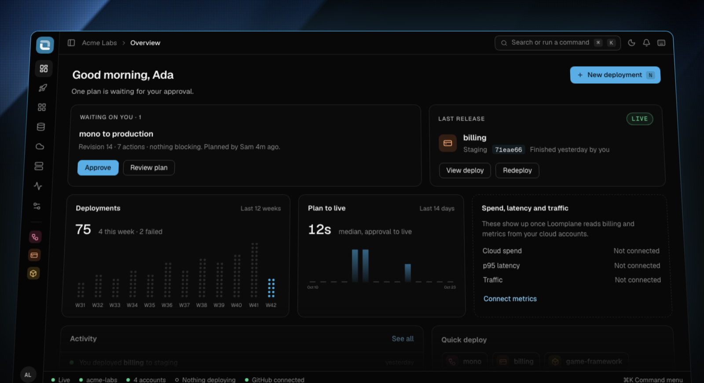
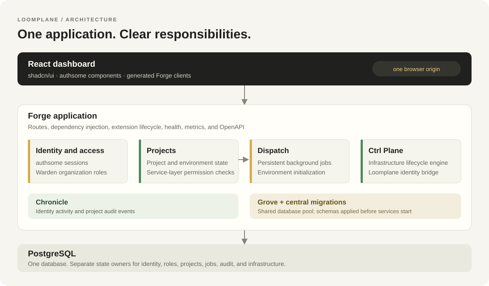

<p align="center">
  
</p>

<h1 align="center">Loomplane</h1>

<p align="center"><strong>Your infrastructure, woven together.</strong></p>

<p align="center">
  A self-hosted deployment platform for the monorepos you already have.<br />
  Built with Go, React, and the Forge ecosystem.
</p>

<p align="center">
  <a href="#quick-start">Quick start</a> ·
  <a href="#deploy-something">Deploy something</a> ·
  <a href="#what-it-does">What it does</a> ·
  <a href="#architecture">Architecture</a> ·
  <a href="#documentation">Documentation</a>
</p>



<p align="center"><sub>Concept artwork inspired by the dashboard's woven environments.</sub></p>

Loomplane takes a Go, Rust, TypeScript, JavaScript, Python or JVM monorepo, or an application split across several repositories, from source to running services across clouds. You give it the repositories. It reads the code (never runs it) to find the services and the databases they need, drafts a `loomplane.yaml`, and plans what deploying it would do. Once someone approves that exact plan, it builds each service on its cloud's own builder and deploys it: a Next.js app to Vercel, a Go API to Cloud Run, a worker to ECS on Fargate, Postgres on Cloud SQL or RDS, wired to each other with secrets kept in each cloud's secret store. Then it keeps checking that what runs is what it deployed.

Your applications don't need Forge, or Go. Everything runs in your own clouds, on your own accounts.

## Quick start

You'll need Go 1.26 (the right patch release downloads itself), Node.js 24 with pnpm, and Docker with Compose for the local PostgreSQL.

```bash
make up                                       # PostgreSQL on localhost:55532
cp config.local.yaml.example config.local.yaml
make setup
make run
```

Open [localhost:8780](http://localhost:8780), create an account, and name your organization.

No Go or Node on your machine? `make stack` builds the image and runs everything in Docker on the same port. It runs in development mode with the development secret key, which is fine on a laptop and nowhere else: set `LOOMPLANE_ENVIRONMENT=production`, `LOOMPLANE_SECRET_KEY` and an https `LOOMPLANE_PUBLIC_URL`, and production refuses to start without them.

For a production host, use the [production Docker guide](docs/docker-production.md). It covers the API, dashboard, analysis worker, Postgres, HTTPS, persistent storage, backups and versioned image releases. To run on Miget instead, follow the [Miget guide](docs/miget.md).

For hot reload while you work on Loomplane itself, `make dev` serves the dashboard on [localhost:5173](http://localhost:5173) and reloads the API as you edit.

## Deploy something

1. **New project**, with a GitHub URL. Any public monorepo works; private ones go through a GitHub App ([docs/github-app.md](docs/github-app.md)).
2. **Analyze**. You get the services it builds, the packages they share and the databases they need, each linked to the line it came from.
3. Open **Deploy**. Loomplane drafts a `loomplane.yaml`; edit it, and save it. [docs/manifest.md](docs/manifest.md) has every field.
4. Under **Integrations**, connect the clouds it names: a Google Cloud service account key, a Vercel token, an AWS access key, a Render API key, a DigitalOcean API token, an Azure service principal. Each is checked with its cloud before it's kept, and Loomplane says which permissions are missing.
5. **Plan** an environment. You see every action, step by step, with anything in the way and anything worth knowing.
6. An admin approves it. You watch each step build, deploy and answer, and the environment shows what runs where.

The same thing from a terminal or CI, with an API key from **Settings, API keys**:

```bash
loomctl login --url http://localhost:8780 --key -
loomctl analyze mono
loomctl manifest save mono -f loomplane.yaml
loomctl plan mono --env production
loomctl approve <plan-id>
```

## What it does

| | |
|---|---|
| Repository discovery | Go, Rust, Node, Python and JVM (Maven and Gradle) monorepos, Dockerfiles and Compose files, with Forge layouts, app roles and scoped backend configuration. [Discovery rules](docs/repository-discovery.md) cover examples and development helpers. |
| `loomplane.yaml` | A versioned manifest, drafted from the analysis: services, resources, gateways, and overrides per environment. |
| Plans | Every action a deployment would take, in order, with problems that block it. Approval names the revision you reviewed; a plan whose world changed comes back stale. |
| Targets | Vercel, Cloud Run, ECS on Fargate, Render, DigitalOcean App Platform and Azure Container Apps for services; Cloud SQL, RDS, Memorystore, ElastiCache, Cloud Storage, S3, Render's Postgres and Key Value, DigitalOcean's Managed PostgreSQL, MySQL and Valkey, and Azure Database for PostgreSQL and MySQL and Azure Managed Redis for databases, caches and buckets. Builds run on Cloud Build, CodeBuild, Vercel, Render, App Platform and ACR Tasks, in your accounts. |
| Networking | Services find each other through variables. ECS services reach each other privately; private Cloud Run services only take calls from the project's own. |
| Gateways | One public address routing paths to services, built on Bastion and run on your infrastructure. |
| Secrets | Variables in layers (organization, project, service, by environment), secrets in Vault and then in each cloud's secret store, never shown again. |
| Recovery | A failed deployment retries from the step that failed. |
| Drift | A scheduled check compares everything deployed with what's live, and the next plan puts it back. |
| Provider plugins | Add a target without changing Loomplane: [docs/providers.md](docs/providers.md). |
| CLI and API keys | `loomctl` for terminals and CI, on keys that act as you with your role, read-only if you like. |
| AI agents | `loomctl mcp` gives an agent tools to analyze, plan and, if you allow it, approve: [docs/agents.md](docs/agents.md). |
| Operations | Backups, restores, safe upgrades and Prometheus metrics: [docs/operations.md](docs/operations.md). |
| Organizations | Members, invitations, Warden roles, and an audit trail of every change. |

## Architecture



Loomplane is one Forge application and a worker. The same Go process serves the dashboard and the API, runs the deployment workflows, and hosts Ctrl Plane; `loomplane-worker` analyzes repositories. Both use one PostgreSQL database.

| Library | What Loomplane uses it for |
|---|---|
| Forge | HTTP, dependency injection, extension lifecycle, health, metrics, OpenAPI, and the CLIs |
| Grove | The database pool and one migration pass over every library's schema |
| authsome | Users, sessions, organizations and invitations |
| Warden | Roles in each organization, checked on every action |
| Dispatch | Jobs, cron, and the durable deployment workflow that waits days for an approval |
| Ctrl Plane | The lifecycle of long-running services on Cloud Run and ECS |
| Vault | Cloud credentials, secret variables and generated database passwords |
| Keysmith | API keys |
| Chronicle | The audit trail |
| Trove | Each deployment's source |
| Bastion | Gateways, generated and run on your infrastructure |

Domain logic is in `internal/`, Forge wiring in `extensions/`. [docs/architecture.md](docs/architecture.md) follows startup, state ownership and trust boundaries; [docs/forge-integration.md](docs/forge-integration.md) has every library pin and what we found wiring each one.

## Who can do what

Your session or API key picks the organization, and nothing in a request can change it. Another organization's things aren't found.

| Role | Can |
|---|---|
| Viewer | Read everything but secret values |
| Developer | Create projects, analyze, edit manifests and variables, plan |
| Admin | Approve plans, retry deployments, manage connections, secrets and members |
| Owner | Everything, including the organization |

An API key acts as the person who made it, with their role, and loses it when they do. [docs/security.md](docs/security.md) covers where every secret lives and how it's tested.

## Configuration

Start with [config.yaml](config.yaml); your own overrides go in `config.local.yaml`, which Git ignores.

| Variable | Default | |
|---|---|---|
| `LOOMPLANE_DATABASE_URL` | required | PostgreSQL. Falls back to `DATABASE_URL`, which platforms like App Platform and Render set for you |
| `LOOMPLANE_SECRET_KEY` | development key | 32 random bytes, base64 (`openssl rand -base64 32`). Every credential and secret is encrypted with keys derived from it, so keep it safe and away from backups. |
| `LOOMPLANE_PUBLIC_URL` | `http://localhost:8780` | Where people reach Loomplane; https in production |
| `LOOMPLANE_ENVIRONMENT` | `development` | `development`, `staging` or `production` |
| `LOOMPLANE_HTTP_ADDR` | `:8780` | |
| `LOOMPLANE_STORAGE_URL` | `.loomplane/storage` | Where deployment sources are kept, `file:///path` |
| `LOOMPLANE_PLANNING_APPROVAL_WINDOW` | `168h` | How long a plan waits for a decision |
| `LOOMPLANE_DRIFT_INTERVAL` | `30m` | How often deployments are checked for drift; `0` turns it off |
| `LOOMPLANE_PLANNING_ENDPOINT_DENIED_CIDRS` | unset | Ranges an endpoint check from a Kubernetes target never connects to, such as `10.20.0.0/16`. Loomplane's own host, database and API are always refused |
| `LOOMPLANE_GITHUB_*` | unset | The GitHub App for private repositories |
| `LOOMPLANE_WORKER_HTTP_ADDR` | `:8781` | The worker's health checks |

Provider plugins are listed under `providers.plugins` in the YAML.

## Development

| Command | |
|---|---|
| `make up` / `make down` | Start or stop PostgreSQL |
| `make dev` | The API and dashboard with hot reload |
| `make build` | `bin/loomplane`, `bin/loomplane-worker` and `bin/loomctl`, with the dashboard built in |
| `make test` | Go and dashboard unit tests |
| `make test-integration` | Boots Loomplane against PostgreSQL, with fake clouds standing in for real ones |
| `make lint` | golangci-lint, the dashboard's type check and ESLint |
| `make vuln` | Known vulnerabilities Loomplane's code reaches |
| `make fuzz` | Fuzz every parser of untrusted input |
| `make gen-client` | Regenerate the dashboard's API clients from the running API |
| `make help` | Everything else |

The OpenAPI document is at `/openapi.json`, and `/swagger` in development. Every `/api/v1` route takes a session or an API key as a bearer token. `pkg/client` is a typed Go client for it.

## Roadmap

| Milestone | Status |
|---|---|
| 0. Ecosystem evaluation | Done |
| 1. Foundation | Done |
| 2. Repository discovery | Done |
| 3. Planning | Done |
| 4. Real deployments | Done; the acceptance run on real Google Cloud and Vercel accounts is next |
| 5. Extended orchestration | Done; acceptance on real AWS likewise |
| 6. Operational maturity | Done |

[docs/implementation-plan.md](docs/implementation-plan.md) has what each milestone covers and what's left over.

## Project layout

```text
loomplane/
├── cmd/
│   ├── loomplane/            The API and dashboard, and backup, restore and migrate
│   ├── loomplane-worker/     Repository analysis
│   └── loomctl/              The command-line client and MCP server
├── internal/
│   ├── apikeys/              API keys on Keysmith
│   ├── clouds/               Google Cloud, AWS, Vercel, Render, DigitalOcean and Azure clients, and Ctrl Plane providers
│   ├── connections/          Cloud connections, credentials in Vault
│   ├── ctl/                  loomctl
│   ├── deployments/          The runner, one executor per target, drift
│   ├── discovery/            Analyses, with the detectors in detect/
│   ├── gateway/              The generated Bastion gateway
│   ├── manifests/, planning/ loomplane.yaml revisions, and the planner
│   ├── ops/                  Backup, restore and upgrade checks
│   ├── plugins/              The provider plugin client
│   ├── telemetry/            Loomplane's metrics
│   └── ...                   config, environments, graph, projects, security, ...
├── pkg/
│   ├── client/               A Go client for the API
│   ├── manifest/             loomplane.yaml and its JSON schema
│   └── provider/             The catalog types, and sdk/ for provider plugins
├── extensions/               Forge wiring
├── examples/                 A polyglot monorepo, and an example provider plugin
├── database/migrations/      Loomplane's schema and every library's migration group
├── apps/dashboard/           The React dashboard
├── tests/integration/        Whole-application tests against PostgreSQL and fake clouds
└── docs/
```

## Documentation

| Guide | When you want to |
|---|---|
| [loomplane.yaml](docs/manifest.md) | Write or edit a manifest |
| [Providers](docs/providers.md) | Add a deployment target with a plugin |
| [Agents](docs/agents.md) | Let an AI agent plan deployments over MCP |
| [Operations](docs/operations.md) | Back up, restore, upgrade and monitor Loomplane |
| [Security](docs/security.md) | Know who can do what and where secrets live |
| [GitHub App](docs/github-app.md) | Analyze private repositories |
| [Architecture](docs/architecture.md) | Follow startup, state ownership and trust boundaries |
| [Forge integration](docs/forge-integration.md) | Check library pins and what we found wiring each one |
| [Implementation plan](docs/implementation-plan.md) | See what each milestone did and what's left |
| [Dashboard](apps/dashboard/README.md) | Work on the React app and its generated clients |

## Contributing

Keep a change focused. Domain behavior belongs in `internal/`, Forge wiring in `extensions/`. Before you send it, run `make lint`, `make test` and `make build`, and the integration suite for anything touching identity, persistence, authorization, deployments or jobs. Regenerate the clients when the API changes, and update [docs/forge-integration.md](docs/forge-integration.md) when you move a library pin.

## License and distribution

Loomplane is free software under the GNU Affero General Public License, version 3 ([LICENSE](LICENSE)). You can run it, change it and share it. If you run a changed Loomplane as a service other people use, you have to offer them the source of your changes too.

Some of the libraries it's built on had their own license questions, recorded in [docs/forge-integration.md](docs/forge-integration.md#licenses).
