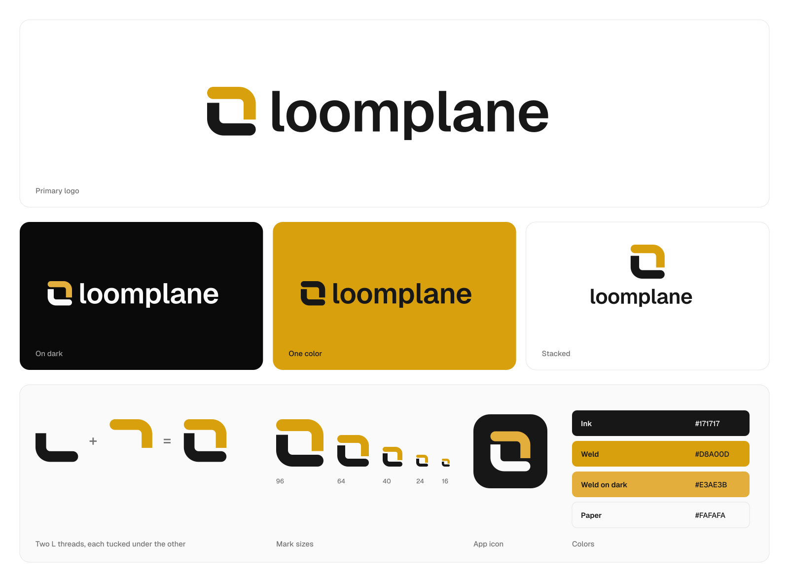

# Loomplane brand



The mark is two threads woven into a square. The dark one is an L. The gold one is the same L turned around, and each tucks under the other at one corner. It's the weave from the dashboard (warp, weft and weld gold) cut down to two threads, so the logo and the product look like they came from the same place.

## Which file to use

Everything in `logo/` is SVG with the name already outlined, so you don't need Geist installed to use it.

| You want | Light background | Dark background |
|---|---|---|
| The full logo | `logo/loomplane-logo.svg` | `logo/loomplane-logo-dark.svg` |
| Stacked, for square spaces | `logo/loomplane-logo-stacked.svg` | `logo/loomplane-logo-stacked-dark.svg` |
| The mark alone | `logo/loomplane-mark.svg` | `logo/loomplane-mark-dark.svg` |
| The name alone | `logo/loomplane-wordmark.svg` | `logo/loomplane-wordmark-dark.svg` |

If you can only print one color, or the logo sits on a photo or on the gold itself, use the `-black` and `-white` files. The weave still reads in one color, because the gaps show where one thread passes under the other.

For browsers and devices, `icon/` has:

- `favicon.svg`, which switches to light threads when the browser is in dark mode, and `favicon.ico` (16, 32 and 48) for older browsers
- `apple-touch-icon.png` at 180 pixels, square, since iOS rounds the corners itself
- `icon-192.png` and `icon-512.png` for a web manifest, drawn from `app-icon.svg`

If you need a PNG for slides or a doc, `png/` has raster copies of the logos.

The favicon is drawn heavier than the mark, with thicker threads and wider gaps. Under about 24 pixels the regular mark's gaps close up and the weave turns into a blob, so if you need anything that small, use the favicon files.

## Colors

| Name | Hex | Used for |
|---|---|---|
| Ink | `#171717` | The L thread and the name on light backgrounds |
| Weld | `#D8A00D` | The gold thread on light backgrounds |
| Weld on dark | `#E3AE3B` | The gold thread on dark backgrounds |
| Paper | `#FAFAFA` | The L thread and the name on dark backgrounds |

These are the dashboard's own tokens. Ink is the theme's `--primary`, and the two golds are `--weld` from the light and dark themes in `apps/dashboard/src/index.css`. If you change the theme, change them here too.

## Space and size

Give the logo clear space of at least half the mark's height on every side, and keep your other graphics (borders included) out of it.

Below about 120 pixels wide you can't read the name anymore, so use the mark on its own.

## Don't

- Recolor the threads, or swap which one is gold.
- Rotate or mirror the mark. Mirrored, the L isn't an L anymore.
- Add shadows, outlines or gradients.
- Retype the name, even in Geist. The outlined name is set tighter than Geist's default spacing, so a retyped one won't match.
- Stretch or squash anything.

## Rebuilding

Every file here comes from `source/`. The geometry is four numbers at the top of `source/build.py`: the square is 32 units, the threads are 8 wide, the outer corner radius is 11, and the gap where one thread passes under the other is 2.5. The favicon uses 9, 12 and 3.

You'll need Python 3 with fontTools and Pillow, `rsvg-convert` (`brew install librsvg`), and Geist's static TTFs from [vercel/geist-font](https://github.com/vercel/geist-font):

```bash
pip install fonttools pillow
LOOMPLANE_FONTS=/path/to/geist/ttf python3 brand/source/build.py
LOOMPLANE_FONTS=/path/to/geist/ttf python3 brand/source/preview.py
```

`build.py` rewrites `logo/`, `icon/` and `png/`. `preview.py` redraws `preview.png`.
