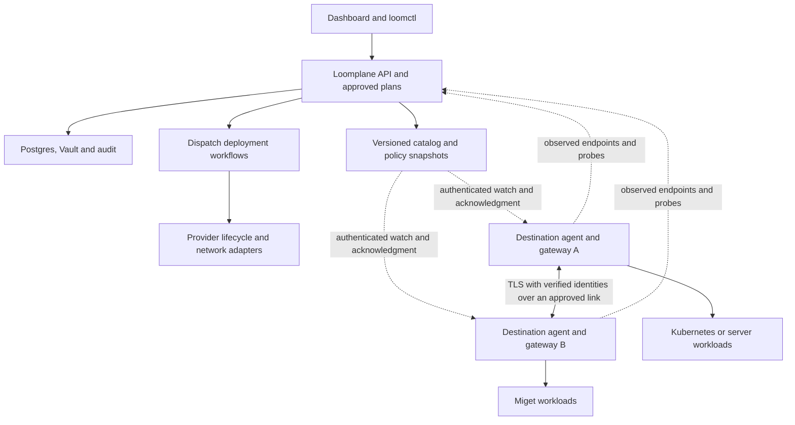

# Cross-cloud orchestration, discovery and secure communication

Date: October 18, 2026. Status: proposed design, ready for implementation review.

You should be able to deploy an application across Kubernetes clusters, servers and managed providers, call its private services by stable names, and choose which workloads may communicate. Miget is the first new managed provider in this design. A successful deployment must establish the network path, prove the caller's identity, enforce the destination's access rules and verify the service from the caller's network.

The accompanying [implementation plan](../plans/2026-10-18-cross-cloud-federation.md) sequences the work. This document records the audit, architecture, security contract and release boundaries. Nothing here marks an unimplemented capability as available.

## Audit scope and evidence

The source audit used the primary `main` checkout at `62fc4cce86b68834ec5e747cb5369a9bc9cb3abe`. The checkout was clean before this documentation work. Source and test inspection establish implementation, not a fresh live-cloud result.

The existing [infrastructure acceptance record](../plans/2026-10-14-own-infrastructure-acceptance.md) records successful local SSH/Docker and kind flows, recovery, private dependencies and Vercel deployment/removal. Those are historical runs. This planning task does not rerun them or establish AWS, GCP or Miget account readiness.

During the audit, `main` advanced to include the [one-click services and data recovery plan](../../one-click-services-plan.md). Its recipe, storage and recovery work shares manifest versioning and resource ownership with this design. Coordinate those contracts before implementation; the federation runtime catalog describes live endpoints, while the recipe catalog describes installable products. The source baseline above remains the basis for this audit's implementation claims.

| Area | What exists in this checkout | Missing work |
| --- | --- | --- |
| Application graph | `internal/discovery`, `internal/graph`, `internal/repositories` analyze repositories, compose sources and attach evidence. | A separate runtime service catalog. Repository discovery does not observe running endpoints. |
| Desired state | `pkg/manifest`, `internal/manifests`, `internal/planning` provide version 1 manifests, source locksets, scoped plans, approval and revision checks. | Destination capabilities, network/access intent, multi-placement services and explicit runtime dependencies. |
| Durable orchestration | `internal/orchestration/deployment.go` uses Dispatch timers, approval signals, activities and replay. `internal/deployments/runner.go` checkpoints work. | Network/policy activation barriers, per-destination reconciliation leases, rollout policy and fenced recovery. |
| Provider abstraction | `pkg/provider/provider.go`, `pkg/provider/sdk`, `internal/plugins` provide catalog, checks, Apply/Remove/Observe and plugin logs. | Typed networking, identity and discovery capabilities; capability negotiation must preserve old plugins. |
| Execution targets | `internal/providers/catalog.go` registers Cloud Run, ECS, Vercel, Render, server, Kubernetes and managed resources. | Miget client, connection checker, lifecycle executor, inventory and networking driver. |
| Kubernetes | `internal/clouds/kubernetes/runtime.go` manages owned Deployments, Services, Secrets, Ingress and HPA. | EndpointSlice watches, least-privilege agent enrollment, service exports/imports and enforced communication policies. |
| Existing servers | `internal/clouds/server` and `internal/deployments/server.go` run containers through checked SSH/Docker connections. | Persistent observation agent, workload enrollment and local service proxy. Existing server placement supports one container per service. |
| Bindings | `internal/planning/plan.go` records one current binding plus old replacements. SQL uniqueness is `(environment_id, subject, name)`. | Explicit placement identity for concurrent replicas in different destinations; endpoint generations and cleanup records independent of active bindings. |
| Current discovery | `Runner.env` injects addresses from `EnvLink` or `Binding.URL`. ECS uses Service Connect inside its environment. | Watched health, expiring endpoints, stable cross-destination resolution, traffic routing and connection draining. |
| Existing cross-cloud link | `internal/planning/links.go` and `internal/deployments/vpn.go` implement the GCP/AWS VPN path with private AWS targets. | Links identified by actual accounts/networks, arbitrary supported destination pairs, imported links and Miget connectivity. |
| Reachability checks | `internal/planning/planner.go` rejects private dependencies across different owned targets; `reachOver` permits the supported GCP-to-AWS path. | A directed reachability graph incorporating routes, DNS, identity and grants. Keep the existing rejection until a verified path replaces it. |
| Gateway | `internal/gateway/program/main.go.txt` generates a Bastion HTTP gateway with routes and addresses fixed at deployment. | Live endpoint updates, verified workload identity, policy revisions, atomic activation and private health checks. |
| Identity and access | Authsome sessions, Keysmith API keys and Warden checks in `internal/security` protect the management API. | Workload identities, trust domains, federation, gateway enrollment and distributed service authorization. A user's API key is not a workload identity. |
| Secrets | `internal/connections/vault.go` and deployment resource secrets use Vault. | Network key and certificate lifecycle, scoped gateway secret delivery and explicit revocation state. |
| Drift | `internal/deployments/drift.go` reads provider state and records discrepancies. Repair requires a plan. | Bounded, explicitly approved repair policies. Ordinary drift observation must remain read-only. |
| Connection ownership | `database/migrations/connection_uses.go` prevents deletion of connections referenced by plans, deployments and bindings. | References from destinations, links, identity issuers, grants and unresolved cleanup. |
| Events and operations | `internal/realtime`, `extensions/realtime`, `internal/telemetry` provide persisted events/logs, replay and metrics. | Endpoint/policy revision events, network diagnostics, bounded traffic records and policy acknowledgment status. |
| Dashboard and CLI | Integrations, infrastructure, project deployment controls, generated Forge clients and `internal/ctl` already exist. | Destination/network/service/access views and commands, plus real failure and revocation flows. |
| Empty states | `apps/dashboard/src/components/zero-state.tsx` has shared left-aligned components. | Reuse them. No registered feature walkthrough was found in the dashboard source search; do not add an inert tour button. |

Dependency pins at audit: Go `1.26.9`, Forge `v1.12.9-0.20261013040932-c8f5fcc38b7c`, Ctrl Plane `v1.7.1-0.20261013050604-236f4beb621f`, Dispatch `v1.8.1-0.20261013040216-46004e7c0445`, Warden `v1.7.2`, Chronicle `v1.8.0`, Vault `v1.7.1`. The generated gateway separately pins Bastion `v1.2.3-0.20261013131827-23c004a37e64`. A sibling Bastion checkout has TLS reload and route administration code, but that is not evidence that the pinned gateway provides the required identity and activation contract. Verify the pinned revision before extending it.

## Product and release scope

You configure destinations, private service exports and communication grants within a Loomplane organization. Initial delivery supports one placement per service, including private calls between destinations. Later tasks add multiple placements, weighted rollout and failover for stateless services. Existing Kubernetes and provider controllers keep responsibility for their own pods, tasks and replicas.

The complete scope includes HTTP, gRPC and bounded TCP service access, Kubernetes and server discovery, Miget deployment/network integration, managed-provider capability checks, health-driven routing, observability and recovery. UDP mesh routing, arbitrary Kubernetes API proxying, automatic database migration, global storage replication and automatic workload relocation based on price are outside this release. Cross-organization federation is a separately gated extension described below; same-organization isolation must work first.

Networking grants never imply Kubernetes administration. Cluster management continues through a separately checked connection and namespace permissions. Importing an existing cluster or service is read-only until you explicitly adopt the resources it will manage.

## Architecture and ownership



Application traffic bypasses the central API. Agents open outbound control connections so a private cluster does not need an internet-facing Kubernetes API. The API stores intent and signed configuration; agents retain valid local configuration during short control-plane interruptions.

| Resource | Reconciliation authority |
| --- | --- |
| Plan, source revision and approved rollout | Loomplane planning service and Dispatch workflow |
| Kubernetes pod and local replica health | Kubernetes Deployment/HPA controllers |
| ECS/Cloud Run instance lifecycle already owned by Ctrl Plane | Existing Ctrl Plane integration |
| Miget application and provider deployment operation | Miget executor through its supported API |
| Network link components | One network driver operation with ownership recorded for both ends |
| Catalog endpoints | Authorized destination observer, fenced by destination and generation |
| Gateway routes and access policy | One local agent applying a versioned snapshot |
| Trust issuance and rotation | SPIRE or an explicitly supported external issuer |

Keep domain packages free of Forge wiring. New `extensions/federation` mounts management routes and connects the stores to Forge, Dispatch, Warden, Chronicle and realtime. It does not create another queue framework or identity database.

## Domain model and persistence

The names below are proposed new contracts. They are not current APIs.

| Object | Scope and required information |
| --- | --- |
| `Destination` | Organization, project/environment authorization, existing connection ID, immutable provider account/cluster UID, namespace, region, network references, capability revision and last observation. Credentials stay on the connection. |
| `NetworkLink` | Two destination/network IDs, direction, imported/managed ownership, transport, CIDRs, DNS strategy, MTU, external component IDs, health, cost/disruption acknowledgment and generation. |
| `ServiceExport` | Stable service ID, environment, explicit ports/protocols, eligible destinations and identity requirement. Export creates no caller permission. |
| `Endpoint` | Export, placement/binding, observer, address, port, zone, readiness, serving/draining state, generation, observation time and lease expiry. Provider URLs and credentials are separate fields. |
| `AccessGrant` | Exact source identity selector, destination export, ports, protocol, optional HTTP methods/paths or gRPC methods, owner, revision and optional expiry. No implicit permission from `needs`. |
| `TrustDomain` | Issuer reference, public bundle version, approved federation relationships and rotation state. Foreign bundles remain bound to their domain. |
| `Agent` | Destination, public identity, enrollment/attestation method, capabilities, heartbeat, applied revision, acknowledgments and revocation epoch. |
| `Placement` | Service, destination, immutable artifact, replicas, traffic weight and rollout generation. Introduced after single-placement federation passes. |
| `CleanupOperation` | Durable external component references, owning connection, retry state, last error and retention policy. Removing an active binding must not erase unresolved cleanup. |

Create additive `loomplane_*` tables through the existing central migration group. Every row and relationship carries organization scope; use composite scope constraints and scoped queries so a foreign identifier cannot bind records across tenants. Unique keys include the relevant environment and destination. Agent observations cannot select another organization in a request body.

Keep legacy bindings intact in the first milestone. For multi-placement, backfill `placement_id = 'default'`, replace the binding uniqueness constraint with `(environment_id, subject, name, placement_id)`, and update every name-keyed lookup before enabling a second placement. Resources remain single-placement unless a future resource-specific replication contract exists. Preserve old plan/workflow decoding while active runs drain.

## Manifest and approval contract

Retain version 1 behavior exactly. Add version 2 with typed `destinations`, `network_links`, `service_exports`, `access_grants` and optional service `placements`; the schema, parser, editor, planner and generated clients must agree before version 2 can be saved. The version 2 destination object references a connection plus provider resource selection. It does not contain credentials.

Version 2 must be a shared transition with the one-click services plan's recipe source, storage and protection sections. Federation does not introduce a competing parser or lifecycle model for managed data. An existing Miget database can begin as an explicitly adopted connection; provisioning, retention, backup and restore require the corresponding resource lifecycle qualification.

An illustrative intent, not currently executable YAML:

```yaml
version: 2
destinations:
  aws-prod:
    connection: conn_example_aws
    namespace: commerce
  miget-prod:
    connection: conn_example_miget
    resource: miget-resource-uuid
    network: miget-vpc-uuid
network_links:
  commerce:
    from: aws-prod
    to: miget-prod
    transport: ipsec
    ownership: imported
service_exports:
  inventory:
    service: inventory
    destination: miget-prod
    ports: [{name: api, protocol: https, port: 8443}]
    identity: workload
access_grants:
  checkout-inventory:
    from: {service: checkout, destination: aws-prod}
    to: inventory
    ports: [api]
    http: {methods: [GET], paths: [/stock/*]}
```

The example abbreviates service definitions and uses placeholder IDs. Parser tests use valid fixtures. Version 2 requires explicit exposure for federated services; importing a version 1 manifest must not silently change its existing public defaults. A `needs` edge supplies ordering/configuration, while an access grant supplies permission. Cyclic runtime communication is valid: stage both services, then activate routes after readiness. It must not create an impossible build/deploy DAG.

Plan hashes include destination identity, reviewed network settings, capability revision, export/grant versions, artifact identity and disruption/cost choices. Volatile health and current certificates do not change the desired-plan hash. Revalidate identity, permissions and relevant capabilities before each external mutation. A change in account, namespace UID, region, trust relationship or effective permission blocks stale approval; token rotation for the same verified scope does not force a deployment.

## Discovery and traffic

Use `internal/runtimecatalog` for runtime discovery. Keep `internal/discovery` dedicated to repository analysis. Kubernetes observers watch Services and EndpointSlices within their permitted namespaces. Server observers inspect only owned containers. Managed providers supply observed application endpoints through API polling, accelerated by verified events where available.

Stable logical names use `<service>.<environment-id>.<project-id>.<org-id>.svc.loomplane.internal` under a configurable private suffix. Validate label and total DNS lengths; service IDs stay immutable across display-name changes. Local DNS answers route callers to an approved local proxy or gateway, avoiding the assumption that remote pod addresses are routable. Provider DNS is resolved in the destination network. Reuse an installed Multi-Cluster Services implementation for Kubernetes exports/imports when available, with explicit mapping from Loomplane scope to cluster/namespace scope. The MCS API defines export/import behavior but does not itself install a network. [MCS overview](https://multicluster.sigs.k8s.io/concepts/multicluster-services-api/)

Proposed initial operational defaults: observations every 10 seconds, endpoint leases of 30 seconds, DNS TTL at most 5 seconds, and three successful probes before readmission. These are design values to test, not measured performance. Expired, unready or revoked endpoints receive no new connections. A 30-second drain limit applies during normal replacement; emergency revocation closes affected connections immediately after local policy application. HTTP retries default to zero for non-idempotent methods; bounded safe retries must fit the caller deadline. TCP connections are never replayed.

Observers use authenticated, versioned snapshots with monotonic generations and a full-resync path. Paginated snapshots have one revision boundary. A reconnect cannot resurrect an endpoint deleted by a newer generation, and persisted tombstones outlive the maximum accepted agent snapshot age. Reject observations of loopback, metadata endpoints or out-of-scope addresses unless the destination profile explicitly permits the local listener being registered.

Local-first routing uses only healthy eligible placements. Failover may select a predeployed placement covered by the approved rollout and access policy. A network partition is not permission to create another writer or redeploy a database elsewhere.

## Identity, authorization and isolation

Use SPIFFE identities with SPIRE on infrastructure where node and workload attestation can be established. Attestation binds an identity to a verified workload selector; a service label supplied by a caller is not sufficient. Keep trust domains separate for distinct administration/security boundaries and establish federation explicitly. SPIFFE federation exchanges trust material for authentication, while Loomplane grants authorize service operations. [Workload registration](https://spiffe.io/docs/latest/deploying/registering/), [SPIFFE federation](https://spiffe.io/docs/latest/spiffe-specs/spiffe_federation/)

Initial mesh access is same-organization and explicit across projects/environments. Cross-organization access needs bilateral export/import approval, separate trust domains, independently revocable grants and policy enforcement by the destination owner. Defer enabling it until those tests exist.

Offer two clearly named identity profiles:

- `workload`: verified workload identity at the source and destination, carried end-to-end or by an authenticated delegation that binds the original caller to the requested export. Use this for fine-grained service rules.
- `gateway`: identity authenticates the destination gateway only. This can authorize that gateway as a principal but cannot claim which application behind it initiated a request. Never advertise it as workload isolation.

Miget workload attestation is unverified. Qualification must establish an application-specific credential or supported attestation path with isolated secret delivery, rotation and no neighboring workload access. If only gateway identity works, block grants requiring `workload`; keep the limitation visible. No assumption of host networking, privileged containers, a SPIRE agent socket or Kubernetes administrator access is permitted.

At gateways, require verified TLS peer identity and exact destination audience. Strip untrusted identity headers. Authorize each HTTP/gRPC request; authorize TCP on connection establishment and terminate it on revocation. Method/path normalization, encoded slashes, HTTP/2 authority and routing names must use the same canonical target. Disable cross-authority redirects. Prove that the backend cannot be reached around the enforcing proxy using network controls or backend authentication. Miget VPC attachment alone is not proof of that property.

Management permissions extend Warden with destination read/manage, network read/manage, service-export manage, access-grant propose/approve/revoke and trust manage. Developers may propose grants; admins approve or revoke them by default. Runtime agent credentials only access their destination protocol, never user sessions or general deployment APIs. Provider tokens, gateway enrollment credentials and workload identities remain separate.

Configuration snapshots are signed, scoped and monotonic, with a five-minute authorization lease renewed every minute. Short-lived workload credentials default to a one-hour maximum validity, renewed before half-life. These are proposed defaults. A disconnected gateway may continue allowed traffic until the earliest policy, grant or credential expiry, then must close affected sessions and deny new ones. A restored gateway starts closed until it establishes a fresh epoch; persisted configuration cannot roll back a revocation. A missing heartbeat appears as stale after 30 seconds. Report revocation as pending until all reachable enforcers acknowledge it; report the offline lease deadline for the others. Never promise instant global revocation during a partition.

## Miget provider contract and qualification

Treat Miget as a managed API provider. The API base is `https://app.miget.com/api/v1`; always pin workspace context. Prefer scoped workspace tokens. They cannot access `/users/me` or administer stored credentials, so readiness checks must use permitted resource endpoints and separately identify administrator setup requirements. Removing the token creator can revoke the token. [API authentication](https://docs.miget.com/api-reference/introduction/)

The following are provider-documented constraints, not account-tested capabilities:

| Provider evidence | Design consequence |
| --- | --- |
| VPCs and their resolvers are regional. External access is a separate networking capability. [VPC overview](https://docs.miget.com/networking/private-networks/overview/) | Pin the region and network; never infer connectivity from a shared workspace. |
| Attach/detach rolls workloads. Attachment DNS may remain stale after redeployment until a later network operation. Subnet public/private describes egress routing. [Attachments](https://docs.miget.com/networking/private-networks/subnets-and-attachments/) | Attach at creation where possible. Prove DNS recovery without destructive refresh loops. Model public application exposure independently. |
| Peer routes are staged and application restarts attached workloads. WireGuard configuration is retrieved once. [VPN](https://docs.miget.com/networking/private-networks/vpn/) | Batch reviewed routes; store one-time secrets directly in Vault and checkpoint completion without logging them. |
| Site-to-site currently uses one AWS tunnel; gateway teardown separately releases the reserved public address. [Site-to-site](https://docs.miget.com/networking/private-networks/site-to-site/) | Advertise single-tunnel availability, retain all cleanup handles, and prove both-end removal. Do not promise HA. |
| Registry deployments expose tag and auto-sync settings; digest-pinned deployment semantics are not established by that documentation. [Registry](https://docs.miget.com/deployments/container-registry/) | Verify immutable artifact support before enabling approved deployments. Disable provider auto-sync. |
| Compose stacks reconcile a repository branch and own child applications/services. [Stacks](https://docs.miget.com/deployments/docker-compose-stacks/) | Direct app management is the first adapter. Stack support needs its own ownership and immutable-source proof; never manage its children concurrently. |
| Signed deployment events can accelerate observation. [Webhooks](https://docs.miget.com/monitoring/webhooks/) | Verify raw-body signature and time window, deduplicate IDs, accept ping, and poll provider state after delivery. Events do not grant authority. |

Before enabling Miget deployment, record sanitized fixtures for app create/update/deploy/status/remove, resource capacity, secrets, private endpoints, ports, logs and cancellation. A mutable tag is acceptable only behind a registry-enforced immutable reference whose digest is recorded and verified; otherwise block approval, not just warn. If the provider cannot report enough identity or endpoint information, leave that capability unavailable with a reason.

For networking, first import a preconfigured IPsec or supported overlay connection and prove connectivity in both directions. Managed IPsec provisioning follows only after the provider handshake is resolved: AWS needs Miget's public address while Miget's documented flow asks for the AWS endpoint. Qualification must prove an allocation/update sequence or require explicit preexisting peer configuration. Do not create throwaway paid tunnels to guess the sequence.

Unknown create outcomes need an operation ledger and lookup by durable external identity. If the provider offers neither idempotency keys nor reliable ownership lookup, stop at `reconciliation-required` after an ambiguous POST. Retrying a paid resource blindly is unacceptable. Honor 429/Retry-After, bounded retries, provider operation IDs, pagination, restricted-project 404 responses and 422 capacity/address failures. Do not adopt an application by display name alone.

## Failure, rollout and deletion rules

1. Provision or adopt network components, then verify the return route and destination-local DNS.
2. Enroll identities and distribute deny-by-default policy to every required enforcer.
3. Start workloads and collect private readiness observations. Existing traffic remains on the old generation.
4. Stage routes and grants together. Activate only when the necessary gateways acknowledge the same generation and the allowed/denied probe pair passes.
5. Shift traffic within the approved rollout policy, drain old connections, then remove the old generation through its original connection.
6. On failure, keep the last valid serving generation. Revert traffic only to a still-authorized, healthy artifact. Never roll back a security revocation with an application rollback.
7. On removal, revoke access and withdraw discovery first. Stop owned workloads, detach owned attachments and remove dependent routes/tunnels before subnets/VPCs. Imported resources survive. Preserve unresolved cleanup and connection references until confirmed gone or explicitly handed off to an operator.

Use optimistic generation checks and a durable lease per environment/destination operation so competing workers cannot both mutate a target. A renewed worker must prove its fencing token before publishing endpoints or activating routes. New durable workflow semantics require a new build identifier while `deployment-v2` runs finish on their existing code.

## Interface and operations

Add compact destination, network and service tabs to Infrastructure, with project/environment filters. An access editor shows source identity, destination export, protocol/ports, expiry and effective decision in one review. Show cost/disruption summaries above the working table. On a connection detail, distinguish configured, reachable, authorized and healthy; green tunnel status cannot hide an expired grant or broken DNS.

Use generated Forge clients, existing cache/event handling and Authsome session plumbing. Reuse shared ZeroState illustrations and keep empty, loading, denied, stale and failed states distinct. Check 1440px desktop and 390px narrow layouts, keyboard focus, wrapped controls, reconnect and organization switching. Only wire a walkthrough if a shared provider and registered route/anchor targets exist.

Record policy changes and administrative actions in Chronicle. Collect endpoint lease age, tunnel loss, probe latency, policy version lag, certificate expiry, denied connections and cleanup backlog through the existing telemetry facilities. Bound labels and buffers: service identifiers belong in scoped events/logs, not unbounded global metric labels. Never capture payload bodies, tokens, private keys or database URLs in traffic diagnostics.

## Acceptance and release gates

| Gate | Required proof |
| --- | --- |
| G0: contract qualification | Pinned gateway feasibility and Miget immutable artifact, identity, endpoint/DNS, permission and IPsec sequencing results are recorded. Unsupported capabilities remain disabled. |
| G1: two-cluster private HTTP | Two isolated networks, one allowed and one denied caller, stable service name, rolling endpoint replacement, no backend bypass and full cleanup. |
| G2: protocols and interruption | gRPC/TCP where supported; expiry, active-session revocation, rotation, stale agent, partition, full resync and restored-agent quarantine. |
| G3: Miget lifecycle | Private image deployment, logs, correct immutable revision, restart recovery, 401/403/404/422/429 paths, replacement and removal. |
| G4: Miget federation | AWS/owned Kubernetes to Miget and reverse permitted call, unauthorized caller denied, DNS after deploy, route-change disruption recorded, tunnel failure and cleanup verified. |
| G5: orchestration | Multiple stateless placements, weighted rollout, bounded failover, capacity limits, one writer for managed data, concurrency fencing and old-workflow upgrade. |
| G6: product release | Installed dashboard/CLI flows, scopes, permissions, desktop/narrow rendering, persisted state, live updates and the complete regression suite. |

The acceptance harness must record expected resources and a baseline inventory, capture actual operation IDs and revisions, and clean up only what it owns. Real cloud runs need configured accounts and an approved resource/cost envelope. Budget limits, missing credentials, unproven Miget behavior and unavailable network permissions are explicit blockers for the affected gate. Mocks can pass without satisfying a live gate.

## Decisions that implementation must close first

- Confirm pinned Bastion can enforce authenticated HTTP/gRPC and atomically replace routes without identity loss. Use a tested standard proxy for unsupported protocols only through an explicit adapter decision; no bespoke TLS, VPN or certificate authority implementation.
- Prove Miget artifact immutability, workload credential isolation and DNS correctness across replacement. Until then, the provider can be connected and inspected but cannot advertise secure federated workload readiness.
- Start with imported IPsec connectivity; prove the two-sided API bootstrap before managing new tunnels. Tailscale is an optional imported transport after ACL and route ownership checks, not an automatic second mesh.
- Keep stateless failover and stateful recovery separate. A database recovery plan must state its replication, consistency, RPO and RTO before any later automatic promotion feature.

All proposed defaults can be revised during implementation review. Changing a security bound or a provider capability requires updating this design, its tests and the release evidence together.
